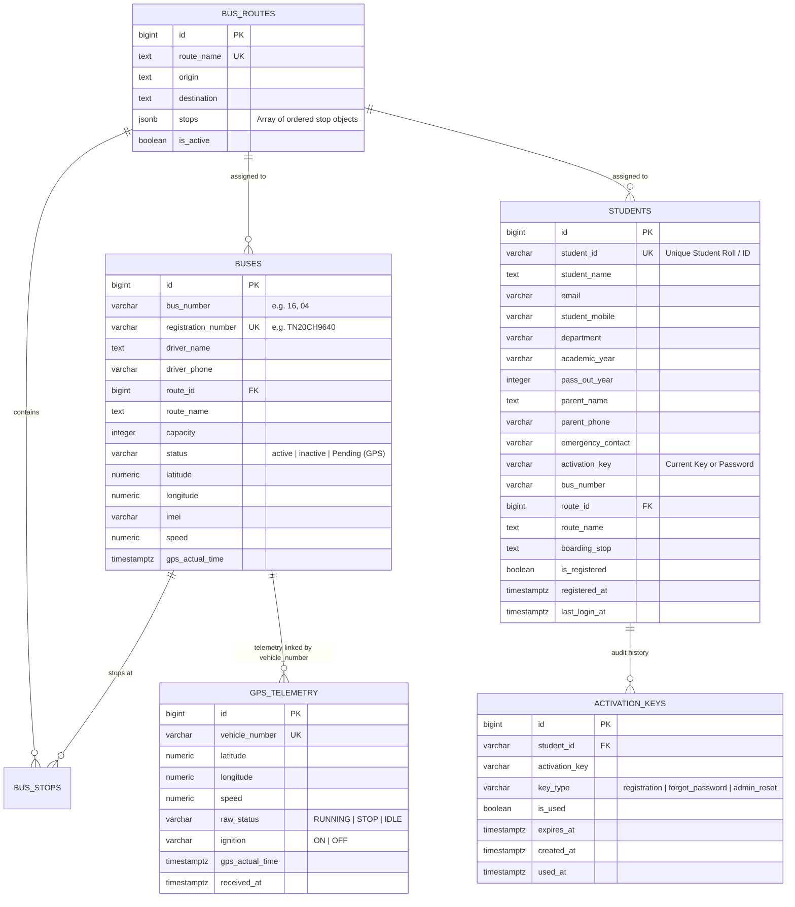

# 🚌 AmcetTransit Backend API — v2.1.0

> Enterprise-grade Transit Management & Real-Time GPS Bus Tracking Backend  
> Designed for College Transportation Systems, Admin Web Portals, and Flutter Mobile Apps.

---

## 📋 Table of Contents
- [1. Project Overview & Tech Stack](#1-project-overview--tech-stack)
- [2. System Architecture & Key Concepts](#2-system-architecture--key-concepts)
- [3. Folder Structure & File Descriptions](#3-folder-structure--file-descriptions)
- [4. Database Schema & Entity Relationships](#4-database-schema--entity-relationships)
- [5. Complete API Endpoints Reference](#5-complete-api-endpoints-reference)
  - [🟢 Public Student Mobile App Endpoints](#-public-student-mobile-app-endpoints-flutter)
  - [🟢 Public Transit & Tracking Endpoints](#-public-transit--tracking-endpoints)
  - [🔒 Protected Fleet & Dashboard Endpoints](#-protected-fleet--dashboard-endpoints)
  - [🔒 Protected Student Management Endpoints](#-protected-student-management-endpoints-admin)
  - [🔒 Protected GPS & Real-time Telemetry Endpoints](#-protected-gps--real-time-telemetry-endpoints)
  - [🔒 Protected System Configuration Endpoints](#-protected-system-configuration-endpoints)
- [6. Environment Variables Guide (.env)](#6-environment-variables-guide-env)
- [7. Setup & Local Development](#7-setup--local-development)
- [8. Diagnostic & Testing Scripts](#8-diagnostic--testing-scripts)

---

## 1. Project Overview & Tech Stack

**AmcetTransit** is an event-driven, production-ready Node.js backend providing real-time telemetry, student transportation management, route dispatching, and authentication.

### Core Technology Stack:
* **Runtime**: Node.js (v18+ LTS, v20+, v22+)
* **HTTP Framework**: Express.js (v5)
* **Database & BaaS**: [Supabase](https://supabase.com/) (PostgreSQL 15+) with dedicated `bus_tracking` schema
* **Real-time Engine**: [Socket.IO](https://socket.io/) (Bi-directional WebSocket streaming)
* **Email Service**: [Brevo HTTP REST API](https://www.brevo.com/) via Axios (automated Smart Console Logger fallback)
* **GPS Integration**:
  * **Automated Pull**: SkyNav GPS Telemetry Scheduler (30s polling cycle)
  * **Direct Push**: High-frequency hardware tracker endpoint (`/api/realtime/gps/update`)

---

## 2. System Architecture & Key Concepts

1. **Dual Envelope API Contract (`student` + `data`)**:  
   To prevent null exceptions across diverse client frameworks (Flutter models, Provider/Bloc/Riverpod state stores, React hooks), all core student and fleet payloads supply both `student: { ... }` and `data: { ... }` envelopes with `{ success: true, message: "..." }`.

2. **Server-Side Activation Key System (`AM-XXXX`)**:  
   Student registration and password resets generate cryptographically random, mobile-friendly 4-character codes prefixed with `AM-` (e.g., `AM-7K9P`), omitting ambiguous characters (`0/O`, `1/I`). This key is dispatched asynchronously via Brevo HTTP API and serves as an instant password or reset token.

3. **Multi-Field Request Body Aliases**:  
   Authentication and registration endpoints flexibly extract client identifiers and verification tokens across varying frontend naming conventions:
   * **Identifiers**: `student_id`, `studentId`, `register_no`, `roll_no`, `id`, `email`, `identifier`, `username`.
   * **Keys / Tokens / OTPs**: `current_key`, `activation_key`, `activationKey`, `token`, `otp`, `code`, `key`, `reset_token`, `resetToken`, `temp_password`, `temporary_password`, `current_password`, `old_password`.

4. **Stateless JWT Verification & Role-Level Access**:  
   The frontend React admin dashboard authenticates against Supabase Auth to obtain a JWT. The Express backend validates this token statelessly via `supabase.auth.getUser()`.

---

## 3. Folder Structure & File Descriptions

```text
web/backend/
├── config/
│   ├── env.js                # Environment variable validation & centralized settings
│   ├── socket.js             # Singleton Socket.IO instance and WebSocket initialization
│   └── supabase.js           # Supabase client factory (Anon & Service Role for bus_tracking)
├── controllers/
│   ├── bus.controller.js     # Bus fleet CRUD controller handlers
│   ├── dashboard.controller.js # Fleet KPI statistics handler
│   ├── public.controller.js  # Unauthenticated bus and tracking endpoints for Flutter
│   └── route.controller.js   # Route and bus stop controller handlers
├── docs/
│   ├── ARCHITECTURE.md       # Detailed technical design & component architecture
│   ├── DATABASE_SCHEMA_SEPARATION.md # Multi-schema transition documentation
│   └── TEAM_WALKTHROUGH.md   # Deployment, scaling, and architectural refactoring notes
├── gps/
│   ├── gps.controller.js     # Manual GPS sync and status inspection controller
│   ├── gps.routes.js         # Express routes for GPS sync & vehicle query endpoints
│   ├── gps.service.js        # SkyNav GPS external API integration client
│   ├── gpsLogger.js          # Prefixed [GPS] console logger for cloud monitors
│   ├── gpsParser.js          # Telemetry sanitization, coordinate bounds & status parser
│   ├── gpsScheduler.js       # Autonomous 30-second background polling cycle
│   └── gpsUpdater.js         # Delta coordinate comparison and Supabase batch updater
├── middleware/
│   ├── auth.middleware.js    # Bearer JWT verification against Supabase Auth
│   ├── error.middleware.js   # Centralized global Express error handler
│   └── logger.middleware.js  # HTTP request logger (Method, URL, Status, Latency)
├── routes/
│   ├── admin.routes.js       # Admin system configuration endpoints (/api/admin)
│   ├── bus.routes.js         # Fleet management routes (/api/buses)
│   ├── dashboard.routes.js   # Fleet KPI routes (/api/dashboard)
│   ├── public.routes.js      # Public Flutter app transit routes (/api/public)
│   ├── realtimeGps.routes.js # Direct hardware telemetry push routes (/api/realtime/gps)
│   ├── route.routes.js       # Route management routes (/api/routes)
│   └── students.js           # Student verification, registration, auth, & roster routes
├── services/
│   ├── admin.service.js      # Database operations for admin system configurations
│   ├── bus.service.js        # Bus operations with dynamic GPS telemetry merge
│   ├── dashboard.service.js  # Fleet statistics aggregator (Active/Inactive/Pending)
│   └── route.service.js      # Route creation, stop normalization, and deletion
├── sql/
│   ├── 01_amcet_schema_separation.sql      # Comprehensive PostgreSQL DDL for bus_tracking schema
│   ├── 04_remove_route_code_migration.sql   # Safe migration to drop route_code column
│   ├── bus_routes_rows.sql                 # Live bus_routes seed data
│   ├── buses_rows.sql                      # Live buses fleet seed data
│   ├── gps_telemetry_rows.sql              # Live GPS telemetry seed data
│   └── students_rows.sql                   # Live student directory seed data
├── utils/
│   ├── httpClient.js         # HTTP client with retry logic & exponential backoff
│   ├── realtimeState.js      # In-memory circular buffer for high-frequency GPS telemetry
│   ├── responseHelper.js     # Standardized JSON response formatters (success / error)
│   ├── email.js              # Brevo HTTP REST API email dispatcher with HTML templates
│   └── sendEmail.js          # Backwards-compatible alias to email.js
├── app.js                    # Express app initialization, CORS, and route mounting
├── diagnose_supabase.js      # Diagnostic suite probing tables in 'bus_tracking' schema
├── server.js                 # HTTP server lifecycle entry point & graceful shutdown
├── test-skynav.js            # Standalone SkyNav provider connectivity tester
├── test-supabase.js          # Fast Supabase database query tester
└── tracker.js                # Local GPS simulator emitting coordinate routes
```

---

## 4. Database Schema & Entity Relationships

All tables reside in the dedicated **`bus_tracking`** schema in PostgreSQL / Supabase.



---

## 5. Complete API Endpoints Reference

### 🟢 Public Student Mobile App Endpoints (Flutter)

#### 1. Verify Student ID
* **Method & URL**: `GET /api/students/verify/:student_id`
* **Headers**: `Content-Type: application/json`
* **URL Param**: `student_id` (e.g. `TEST999`)
* **Success Response (`200 OK`)**:
  ```json
  {
    "success": true,
    "message": "Student ID verified successfully.",
    "student": {
      "id": 1349,
      "student_id": "TEST999",
      "student_name": "Lokesh Nagarajan",
      "email": "lokesh@example.com",
      "student_mobile": "9876543210",
      "year": "3rd Year",
      "academic_year": "3rd Year",
      "department": "CSE",
      "route_id": 1,
      "route_name": "SANKARANPALAYAM",
      "bus_number": "04",
      "stop_name": "Old Bus Stand",
      "boarding_stop": "Old Bus Stand",
      "is_registered": false
    },
    "data": { ... },
    "student_id": "TEST999",
    "student_name": "Lokesh Nagarajan",
    "is_registered": false
  }
  ```
* **Error Response (`404 Not Found`)**:
  ```json
  {
    "success": false,
    "error": "Student ID not found in college records.",
    "message": "Student ID not found in college records."
  }
  ```

---

#### 2. Student Self-Registration
* **Method & URL**: `POST /api/students/register`
* **Request Body**:
  ```json
  {
    "student_id": "TEST999",
    "student_name": "Lokesh Nagarajan",
    "email": "lokesh@example.com",
    "route_name": "SANKARANPALAYAM",
    "stop_name": "Old Bus Stand",
    "department": "CSE",
    "academic_year": "3rd Year",
    "student_mobile": "9876543210"
  }
  ```
* **Success Response (`201 Created`)**:
  ```json
  {
    "success": true,
    "message": "Registration successful! Your temporary password has been sent to your registered email (lo***h@example.com).",
    "student": {
      "id": 1349,
      "student_id": "TEST999",
      "student_name": "Lokesh Nagarajan",
      "email": "lokesh@example.com",
      "route_name": "SANKARANPALAYAM",
      "bus_number": "04",
      "is_registered": true,
      "registration_status": "Registered"
    },
    "data": { ... },
    "email_sent": true,
    "email_hint": "lo***h@example.com"
  }
  ```
* **Error Response (`409 Conflict`)**:
  ```json
  {
    "success": false,
    "error": "This Student ID is already registered. Please sign in or use \"Forgot Password\" to retrieve your credentials.",
    "message": "This Student ID is already registered. Please sign in or use \"Forgot Password\" to retrieve your credentials."
  }
  ```

---

#### 3. Student Sign-In
* **Method & URL**: `POST /api/students/login`
* **Request Body** (Supports `student_id` or `email`, and `password` or `activation_key`):
  ```json
  {
    "student_id": "TEST999",
    "password": "AM-7K9P"
  }
  ```
* **Success Response (`200 OK`)**:
  ```json
  {
    "success": true,
    "message": "Login successful!",
    "student": {
      "id": 1349,
      "student_id": "TEST999",
      "student_name": "Lokesh Nagarajan",
      "email": "lokesh@example.com",
      "department": "CSE",
      "academic_year": "3rd Year",
      "route_id": 1,
      "route_name": "SANKARANPALAYAM",
      "bus_number": "04",
      "vehicle_number": "TN20CH9640",
      "driver_name": "LOKII",
      "driver_phone": "1654655464",
      "bus_status": "Active",
      "is_registered": true
    },
    "data": { ... }
  }
  ```
* **Error Response (`401 Unauthorized`)**:
  ```json
  {
    "success": false,
    "error": "Invalid Student ID or Password / Activation Key.",
    "message": "Invalid Student ID or Password / Activation Key."
  }
  ```

---

#### 4. Forgot Password (Generate & Email New Key)
* **Method & URL**: `POST /api/students/forgot-password`
* **Request Body**:
  ```json
  {
    "student_id": "TEST999"
  }
  ```
  *(Accepts `student_id`, `studentId`, `email`, `register_no`, `roll_no`, or `identifier`)*
* **Success Response (`200 OK`)**:
  ```json
  {
    "success": true,
    "message": "A new activation key has been sent to your registered email address (lo***h@example.com).",
    "email_hint": "lo***h@example.com",
    "email_sent": true
  }
  ```

---

#### 5. Reset Password
* **Method & URL**: `POST /api/students/reset-password`
* **Request Body**:
  ```json
  {
    "student_id": "TEST999",
    "otp": "AM-7K9P",
    "new_password": "MyNewSecurePassword123"
  }
  ```
  *(Accepts key aliases: `otp`, `code`, `activation_key`, `token`, `key`, `current_password`, `temp_password`)*
* **Success Response (`200 OK`)**:
  ```json
  {
    "success": true,
    "message": "Password reset successfully! You can now sign in with your new password."
  }
  ```
* **Error Response (`401 Unauthorized`)**:
  ```json
  {
    "success": false,
    "error": "Invalid activation key, OTP, or reset token.",
    "message": "Invalid activation key, OTP, or reset token."
  }
  ```

---

### 🟢 Public Transit & Tracking Endpoints

#### 6. Get All Buses & Stops (Flutter Route List)
* **Method & URL**: `GET /api/public/buses`
* **Success Response (`200 OK`)**:
  ```json
  {
    "success": true,
    "message": "Buses retrieved successfully",
    "data": [
      {
        "id": 2,
        "routeId": 1,
        "routeName": "SANKARANPALAYAM",
        "busNo": "Bus 04",
        "busId": "04",
        "driverName": "LOKII",
        "driverPhone": "1654655464",
        "forwardStops": ["STOP 1", "STOP 2", "CAMPUS"],
        "registrationNumber": "TN20CH9640",
        "status": "Pending (GPS)"
      }
    ]
  }
  ```

#### 7. Live Bus Tracking Detail
* **Method & URL**: `GET /api/public/buses/:id/tracking`
* **Success Response (`200 OK`)**:
  ```json
  {
    "success": true,
    "message": "Tracking data retrieved successfully",
    "data": {
      "routeId": "2",
      "vehicleId": "TN20CH9640",
      "latitude": 12.9165,
      "longitude": 79.1325,
      "updatedAt": "2026-10-21T18:00:00.000Z",
      "speedKph": 42.5,
      "status": "RUNNING",
      "ignition": "ON"
    }
  }
  ```

---

### 🔒 Protected Fleet & Dashboard Endpoints

> **Authentication Required:** Send `Authorization: Bearer <supabase_access_token>`

#### 8. Dashboard Fleet KPI Cards
* **Method & URL**: `GET /api/dashboard`
* **Response (`200 OK`)**:
  ```json
  {
    "success": true,
    "message": "Fleet stats retrieved successfully",
    "data": {
      "totalBuses": 12,
      "activeBuses": 8,
      "offlineBuses": 2,
      "pendingGps": 2,
      "lastSyncAt": "2026-10-21T17:42:00.000Z"
    }
  }
  ```

#### 9. Buses Management
* `GET /api/buses` — List all buses enriched with route stops and telemetry.
* `GET /api/buses/:id` — Get single bus details by primary key.
* `POST /api/buses` — Create new bus with payload: `{ bus_number, registration_number, driver_name, driver_phone, route_id, capacity }`.
* `PUT /api/buses/:id` — Update bus metadata.
* `DELETE /api/buses/:id` — Remove a bus.

#### 10. Route Management
* `GET /api/routes` — List all bus routes.
* `GET /api/routes/:id` — Get route and stops by ID.
* `POST /api/routes` — Create route: `{ route_name, origin, destination, stops: ["STOP 1", "STOP 2"] }`.
* `PUT /api/routes/:id` — Update route details and re-ordered stop list.
* `DELETE /api/routes/:id` — Delete a route.

---

### 🔒 Protected Student Management Endpoints (Admin)

* `GET /api/students` — Fetch paginated student roster with transit metadata (Chunked >1,000 bypassing PostgREST row limits).
* `POST /api/students/import` — Bulk CSV / array upload of pre-loaded student records.
* `PUT /api/students/:id` — Update student profile, assigned bus, or boarding stop.
* `DELETE /api/students/:id` — Remove student record.

---

### 🔒 Protected GPS & Real-time Telemetry Endpoints

* `GET /api/gps/status` — Returns background GPS scheduler status, last sync timestamp, and active interval.
* `GET /api/gps/sync` — Manually triggers an immediate SkyNav synchronization run.
* `POST /api/realtime/gps/update` — Direct push endpoint from hardware trackers or simulators:
  ```json
  {
    "bus_id": "BUS001",
    "latitude": 13.0827,
    "longitude": 80.2707,
    "speed": 45,
    "heading": 90
  }
  ```
* `GET /api/realtime/gps/live` — Returns the latest hardware GPS packet stored in-memory.
* `GET /api/realtime/gps/history` — Returns memory-cached telemetry history since process start.
* `GET /api/realtime/gps/history/db` — Queries persistent `gps_logs` table from database.

---

### 🔒 Protected System Configuration Endpoints

* `GET /api/admin/configs` — Fetches key-value configurations from `admin.system_configs`.
* `PUT /api/admin/configs/:key` — Upserts a system configuration setting.

---

## 6. Environment Variables Guide (.env)

Create a `.env` file in the `web/backend/` root directory:

```ini
# Server Settings
PORT=3001
NODE_ENV=development
FRONTEND_URL=http://localhost:8000,http://localhost:5173

# Supabase Credentials
SUPABASE_URL=https://your-project.supabase.co
SUPABASE_ANON_KEY=eyJhbGciOi...
SUPABASE_SERVICE_ROLE_KEY=eyJhbGciOi...

# SkyNav GPS Provider (Optional for local dev, mandatory in production)
SKYNAV_API_URL=https://api.skynavgps.com/v2
SKYNAV_BEARER_TOKEN=your_skynav_token
SKYNAV_USERNAME=your_username
SKYNAV_PASSWORD=your_password
SKYNAV_PROJECT_ID=your_project_id
SKYNAV_COMPANY_NAME=AMCET
SKYNAV_POLL_INTERVAL_MS=30000

# Brevo HTTP REST API Credentials (Student Activation & Password Resets)
BREVO_API_KEY=your_brevo_api_key_here
SENDER_EMAIL=your-verified-sender@example.com
SENDER_NAME=AMCET Transport
```

---

## 7. Setup & Local Development

### 1. Install Dependencies
```bash
cd web/backend
npm install
```

### 2. Verify Database Connection
```bash
node diagnose_supabase.js
```

### 3. Start Server in Development Mode
```bash
npm run dev
# OR for standard production node start:
npm start
```
The server will boot on port `3001` (or your configured `PORT`), attach Socket.IO, verify Brevo REST API service, and initiate the GPS scheduler.

---

## 8. Diagnostic & Testing Scripts

The repository includes standalone diagnostic utilities that run without launching the full server:

| Script | Purpose | Command |
| :--- | :--- | :--- |
| **`diagnose_supabase.js`** | Probes all core tables (`buses`, `students`, `bus_routes`, etc.) in the `bus_tracking` schema. | `node diagnose_supabase.js` |
| **`test-supabase.js`** | Quick sanity test confirming DB query execution and HTTP status. | `node test-supabase.js` |
| **`test-skynav.js`** | Tests network authentication and telemetry packet responses from the SkyNav GPS provider. | `node test-skynav.js` |
| **`tracker.js`** | Simulates a live bus transmitting coordinate updates to the local API every 5 seconds. | `node tracker.js` |
