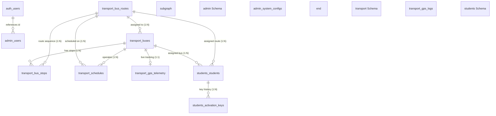

# AMCET Transport Management System — Database Schema Separation Architecture

> **Document Version:** 3.0.0  
> **Database Engine:** PostgreSQL 15+ / Supabase  
> **Backend Integration:** Node.js (Express.js) & `@supabase/supabase-js` v2  
> **Date:** October 2026  

---

## 1. Executive Summary & Architectural Motivation

Previously, all database tables for AMCET Transit were grouped in PostgreSQL's default `public` schema. As the system scales to accommodate 100+ buses, 5,000+ students, automated IoT GPS feeds, and role-based administrative personnel, maintaining monolithic tables in `public` creates security and organizational risks:

1. **Security & Principle of Least Privilege:** IoT telemetry sync engines, student mobile self-registration, and administrative auditing require strictly segregated access privileges.
2. **Namespace Cleanliness & Modularity:** Grouping related domains into discrete schemas ensures clear data ownership and prevents naming collisions.
3. **Optimized Row Level Security (RLS):** Policies are simpler and cleaner to audit when scoped by schema.
4. **Zero-Downtime Migration:** With PostgreSQL views in `public`, existing applications continue running without interruption while new clients use the partitioned schemas.

---

## 2. Multi-Schema Architecture Diagram



---

## 3. Detailed Schema Breakdown

### 3.1. `transport` Schema (Fleet & Tracking Operations)

| Table | Purpose | Primary Key | Key Foreign Keys |
|---|---|---|---|
| `transport.buses` | Fleet vehicles, drivers, license, and capacity | `id` (BIGINT) | `route_id` -> `transport.bus_routes(id)` |
| `transport.bus_routes` | Transit lines, origins, destinations, and JSONB stops sequence | `id` (BIGINT) | None |
| `transport.bus_stops` | Ordered pickup/drop points for buses and routes | `id` (BIGINT) | `bus_id` -> `transport.buses(id)` ON DELETE CASCADE, `route_id` -> `transport.bus_routes(id)` |
| `transport.schedules` | Morning/evening operating times and days | `id` (BIGINT) | `bus_id`, `route_id` |
| `transport.gps_telemetry` | Real-time vehicle location, speed, ignition, and status | `id` (BIGINT) | `vehicle_number` -> `transport.buses(registration_number)` ON UPDATE CASCADE |
| `transport.gps_logs` | Historical time-series coordinates for route replay | `id` (BIGINT) | None |

### 3.2. `students` Schema (Student Management & Mobile Registration)

| Table | Purpose | Primary Key | Key Foreign Keys |
|---|---|---|---|
| `students.students` | Student profiles, college roster, device status, activation keys, and transit allocation | `id` (BIGINT) | `bus_id` -> `transport.buses(id)` ON DELETE SET NULL, `route_id` -> `transport.bus_routes(id)` ON DELETE SET NULL |
| `students.activation_keys` | Audit history of temporary `AM-XXXX` mobile app activation keys and password reset tokens | `id` (BIGINT) | `student_id` -> `students.students(student_id)` ON DELETE CASCADE |

### 3.3. `admin` Schema (System Governance & Auditing)

| Table | Purpose | Primary Key | Key Foreign Keys |
|---|---|---|---|
| `admin.users` | Admin metadata & permissions linked to Supabase Auth | `id` (UUID) | `id` -> `auth.users(id)` ON DELETE CASCADE |
| `admin.system_configs` | Dynamic key-value system settings (polling rates, active terms) | `id` (BIGINT) | `updated_by` -> `auth.users(id)` |

---

## 4. Foreign Key Integrity & Indexing Strategy

### 4.1. Cross-Schema Constraints
PostgreSQL enforces foreign key constraints across schemas seamlessly:
- **Cascade Deletions for Bus Stops:** When a bus is deleted, associated stops in `transport.bus_stops` are automatically cascaded.
- **Protective Nullification for Students:** If a bus or route is modified/removed, `students.students.bus_id` and `students.students.route_id` are safely set to `NULL` (`ON DELETE SET NULL`), preventing accidental deletion of student profiles.
- **Cascading Vehicle Registration Updates:** `transport.gps_telemetry.vehicle_number` has `ON UPDATE CASCADE` referencing `transport.buses.registration_number`.

### 4.2. Performance Indexes
- **Case-Insensitive Uniqueness:**
  - `transport.buses (UPPER(registration_number))`
  - `students.students (UPPER(student_id))`
  - `students.students (LOWER(email))`
- **Composite Query Indexes:**
  - `transport.bus_stops (bus_id, stop_order)` for instant ordered stop lists.
  - `transport.gps_telemetry (received_at DESC)` for the latest fleet telemetry.
  - `transport.gps_logs (bus_id, received_at DESC)` for vehicle location history queries.
  - `students.students (department, academic_year)` for admin filtering and cohort exports.

---

## 5. Supabase Client Configuration in Node.js

The backend uses `@supabase/supabase-js` configured in [`config/supabase.js`](file:///c:/Users/lokesh/Documents/flutter/BUSSYSTEM/web/backend/config/supabase.js).

### 5.1. Ergonomic Schema Client Access (`db`)
Instead of monolithic queries, controllers and services use schema-bound query builders:

```javascript
const { db } = require("../config/supabase");

// 1. Querying Transport Schema
const { data: buses } = await db.transport
  .from("buses")
  .select("id, bus_number, registration_number, status");

// 2. Querying Students Schema
const { data: student } = await db.students
  .from("students")
  .select("*")
  .eq("student_id", "STD-2024-001")
  .single();

// 3. Querying Admin Schema (System Configs)
const { data: configs } = await db.admin
  .from("system_configs")
  .select("*");
```

### 5.2. PostgREST Schema Headers
Under the hood, `@supabase/supabase-js` translates `.schema('transport')` into HTTP headers for PostgREST:
- `Accept-Profile: transport` (for `GET` requests)
- `Content-Profile: transport` (for `POST`, `PATCH`, `DELETE` requests)

---

## 6. Supabase Studio Configuration (Mandatory Step)

To allow the Supabase API to expose non-public schemas, configure PostgREST exposed schemas:

1. Open your **Supabase Dashboard**: [https://supabase.com/dashboard](https://supabase.com/dashboard)
2. Select your project: **AMCET Transit**
3. Navigate to: **Project Settings** (gear icon) ➔ **API**
4. Locate the **"Exposed schemas"** input field.
5. Add the schemas separated by commas:
   ```
   public, transport, students, admin
   ```
6. Click **Save**. PostgREST will reload automatically within a few seconds.

---

## 7. Migration Execution Guide

### Step 1: Run the Migration Script
Open the **SQL Editor** in Supabase and run:
[`backend/sql/01_amcet_schema_separation.sql`](file:///c:/Users/lokesh/Documents/flutter/BUSSYSTEM/web/backend/sql/01_amcet_schema_separation.sql)

This script:
- Creates `transport`, `students`, and `admin` schemas.
- Grants permissions to `anon`, `authenticated`, and `service_role`.
- Creates all tables with constraints, indexes, and triggers.
- Idempotently copies existing data from `public` tables.
- Enables Row Level Security (RLS) with explicit policies.
- Creates updatable views in `public` for zero-downtime backward compatibility.

### Step 2: Verify Schema Health
In the Supabase SQL Editor, execute:
[`backend/sql/02_test_verification_queries.sql`](file:///c:/Users/lokesh/Documents/flutter/BUSSYSTEM/web/backend/sql/02_test_verification_queries.sql)

Verify that:
- All 11 tables exist across the 3 schemas.
- Foreign keys and indexes are reported as active.
- Row Level Security (`rowsecurity = true`) is enabled on all tables.
- Cross-schema join queries return expected data.

### Step 3: Start / Restart the Backend Server
```bash
npm run dev
```

The Express server will automatically route queries to the separated schemas.
